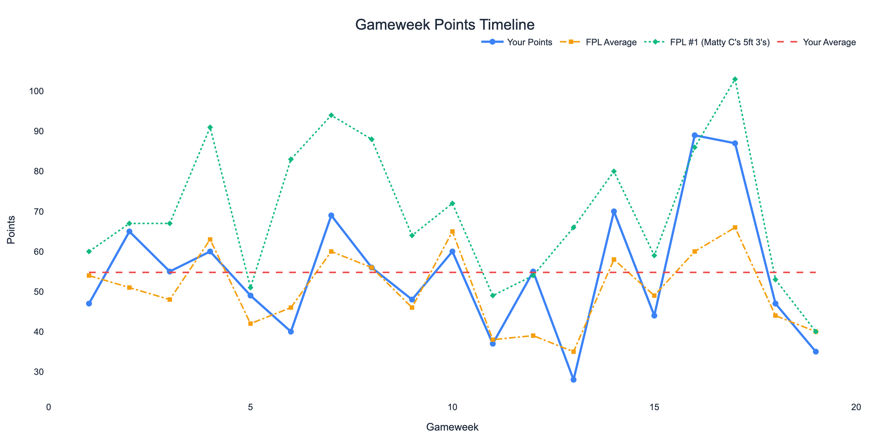
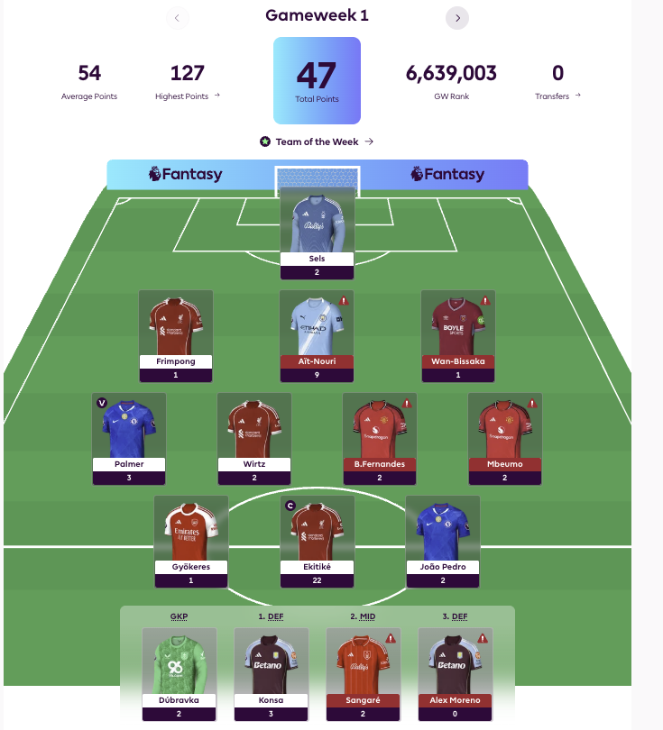
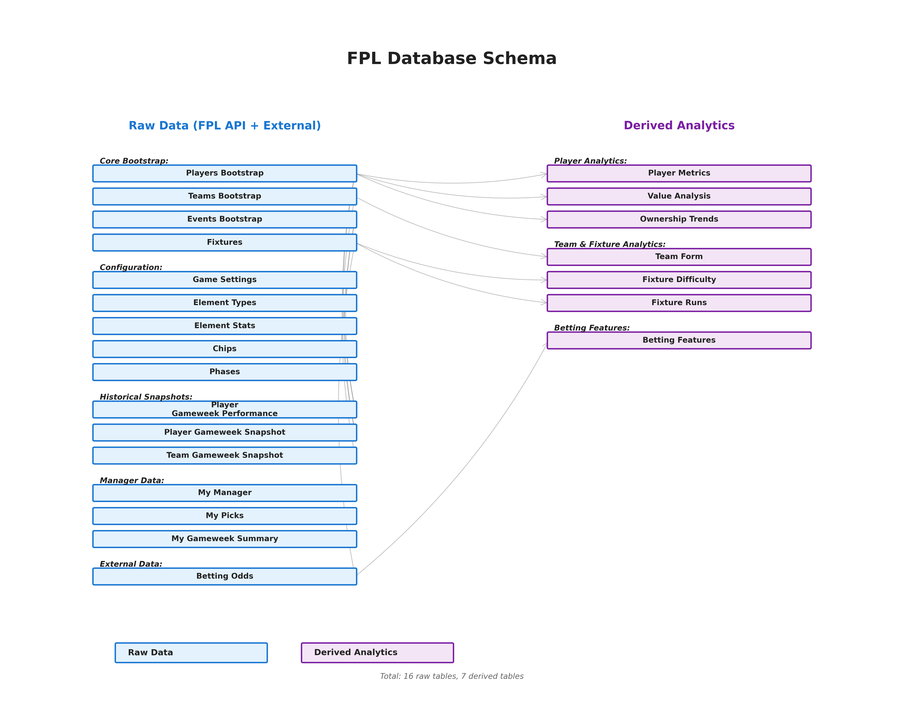
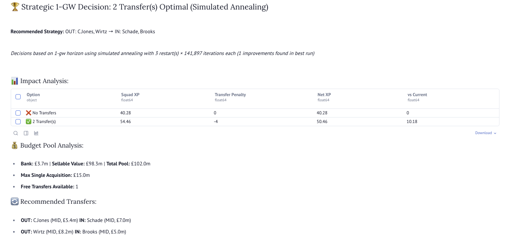
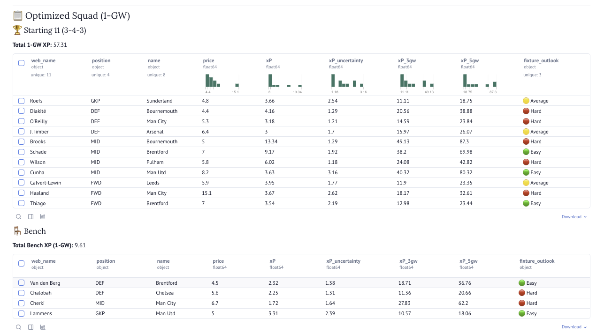
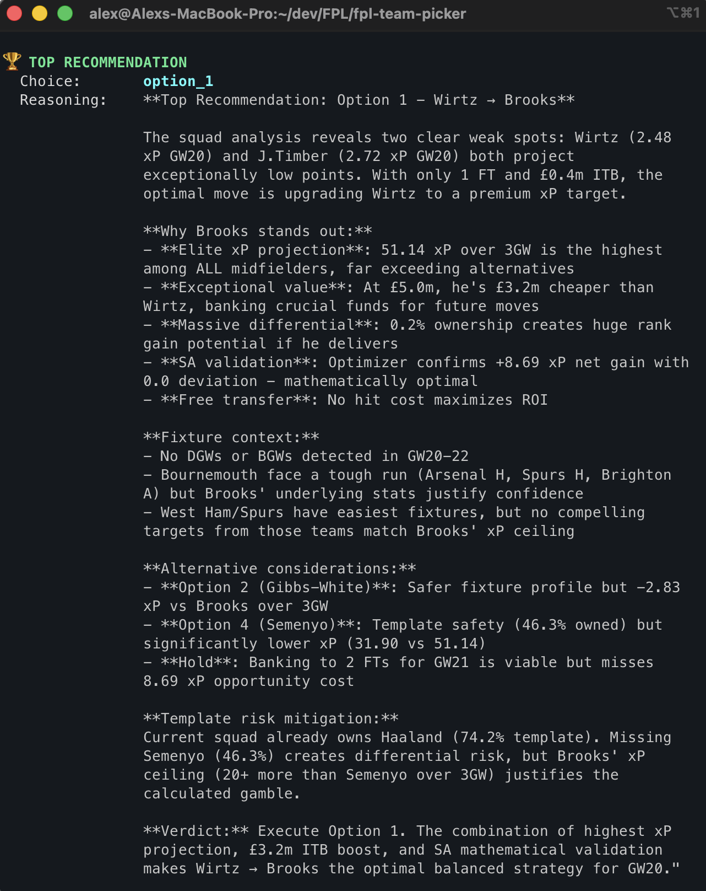
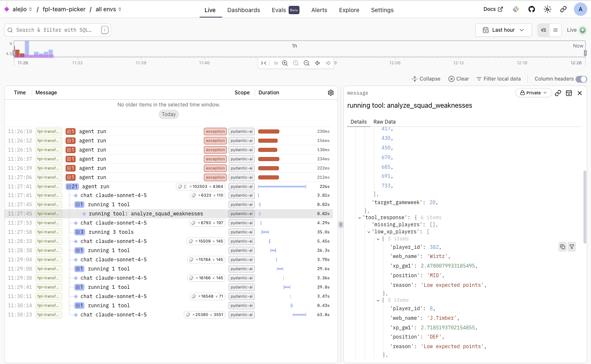

This is the first post in a series about my ML system for Fantasy Premier League.

**Gameweek 19**. The exact midpoint of the Premier League season.

> After five months of work, 395 commits, and over 800 tests, I’ve built a production-minded system with reproducible pipelines, a CLI, and built-in observability. 

This isn't a success story. At least, not yet.

**tl;dr**

- **What I built**: A data pipeline, an ML model for expected points, a squad optimiser, and an experimental LLM agent for transfers.
- **Current performance**: Rank ~2.7m of 11m players, but 86 points above the average.
- **What’s novel**: Betting-derived features, a hauler-focused loss function, and agentic tools in addition to pure optimisation.
- **What’s next**: Multi-gameweek planning, better uncertainty quantification, and further automation.

*Points per gameweek compared to FPL average and the current #1 manager:*

---

## What is FPL?

Fantasy Premier League (FPL) is a free fantasy football game. You select 15 Premier League players with a £100m budget. Your players get points for their real performance (goals, assists, clean sheets). Each week, you make transfers to improve your squad. You compete against millions of other managers on a global leaderboard.

> The core problem: **predict player points and optimise transfers, team selection and captaincy under constraints**, then layer strategy over the optimiser.

For me, it's an excellent ML playground:

- **Bounded domain**: 15 players, £100m budget, clear rules
- **Weekly feedback loop**: no hiding from results
- **Rich data**: years of history, real-time updates, betting markets
- **Real competition**: 11M+ active players, measurable ranking

---

## Why I'm doing this

I wanted a project for end-to-end data work, without the restrictions of a professional environment: data collection, ML and agentic systems, in a domain with clear, measurable results.

Also, I got tired of consecutive years of sucking at FPL and decided to finally combine my professional specialty with one of my hobbies.

And despite all that sophistication? I'm currently ranked around 2.7 million out of 11 million managers 😅 But I think the system is now close to something good.

---

## The journey so far

The system has 25 database tables, 15 domain services, reproducible training, a test suite and observability for the agent.

The architecture had three phases:

| Phase | Focus | Key Outcome |
|-------|-------|-------------|
| **Manual Control** | Interactive notebooks, rules-based picks | Learning the domain |
| **ML Predictions** | 156 features, custom loss functions | Better signals |
| **Agentic Reasoning** | LLM + tools, strategic context | Autonomous strategy |

The code is in two repositories: `fpl-dataset-builder` (data collection and enrichment) and `fpl-team-picker` (analysis, ML and the agent).

### Phase 1: Manual control (July–Aug)

I started where every data person starts: interactive notebooks. The first goal was a tool to pick the initial 15-player squad.

In [Marimo](https://marimo.io/) (a reactive Python notebook), I built an interface to explore the data and make rules-based predictions of expected points. The predictions were easy to understand and adjust. A greedy optimiser picked the best available player for each position within the budget.

The results made intuitive sense:

*First gameweek squad:*

I then adapted the algorithm to pick the best transfers and starting 11 for each gameweek. But a rules-based system does not learn, so I changed the approach.

### The data foundation

One thing I'm particularly proud of: the database.

*Database schema:*

25 SQLite tables split into two layers:

**18 raw tables** capturing FPL data:
- 775 players, 380 fixtures, 38 gameweeks
- 13,395 player-gameweek observations
- My 270 picks across 18 gameweeks, chip usage, transfer history
- 190 fixtures with betting odds (Bet365, Pinnacle, market movements)

**7 derived tables** where the real value lives:
- Ownership trends: bandwagon detection, template players, transfer momentum
- Value analysis: points-per-million, buy/sell/hold recommendations
- Fixture difficulty: multi-factor analysis beyond FPL's simple 1–5 rating
- Team form: venue-specific attack/defence strength
- Betting features: implied probabilities, clean sheet likelihood, xG from odds

> **Pydantic validates all data.** This is important: code assistants often add fallbacks to "make it work" instead of fixing upstream data issues. Strict validation forces correct data at the source.

### Phase 2: ML predictions (Sept–Dec)

With the data foundation complete, I built an ML pipeline with 156 features: form, fixtures, ownership trends, betting odds, injury risk, venue-specific team strength.

Key design decisions:

- Custom loss functions that find **haulers** (players who score ~10+ points in a gameweek), instead of only minimising average error
- Evaluation on >2 full gameweek holdout datasets
- A hybrid training pipeline that compares one unified model against position-specific models (GKP, DEF, MID, FWD), with hyperparameter tuning
- A **simulated annealing (SA)** optimiser that explores beyond greedy local maxima

*Example of the transfer optimisation results:*

*Example of the starting 11 optimisation:*

But each gameweek still needed many "human-in-the-loop" decisions: training strategy, risk appetite (conservative, balanced or aggressive) and captain selection. Many of these decisions were arbitrary.

### Phase 3: Agentic reasoning (Dec–today)

Predictions are not sufficient. Example: the ML model gives Haaland 8.2 **xP** (expected points) and Saka 7.8 xP. The optimiser picks Haaland.

A strategic manager asks different questions. There is a **double gameweek (DGW)** in 3 weeks: do I save the transfer? Do I take a points hit to avoid a price rise? If I protect my rank, what about **template safety** (cover highly-owned players to limit downside)?

This is strategic reasoning, not calculation. The optimiser maximises expected points; it cannot reason about context.

So I'm building an LLM agent. It uses the ML predictions as a tool and adds strategic reasoning: DGWs, fixture swings, chip timing, template safety. It's experimental, but it's the "brain" in "Engineering an FPL Brain."

Pure optimisation works well for one gameweek, but it can be fragile. For example, it can spend your last £0.5m today to upgrade a bench defender. Two weeks later, **Bryan Mbeumo** returns from **AFCON** and you are £0.1m short to buy him back. The agent prevents this type of error. `analyze_fixture_context` finds fixture swings, and `get_template_players` prevents differential traps.

*Running the agent CLI:*

The orchestrator sends tasks to 5 specialised tools (multi-GW xP predictions, fixture context analysis, SA optimiser validation, squad weakness detection, template player analysis). It then combines the results into recommendations.

*Output of the agent CLI:*

At the moment, the agent gives only transfer recommendations, not full team and captain selection. I use [Pydantic AI](https://ai.pydantic.dev/) as the agent framework for its structured outputs, and [Logfire](https://logfire.pydantic.dev/) for observability.

*Logfire trace:*

---

## Where this is heading

**Short-term** (next 3–4 months): Refine the LLM agent: more tools, better reasoning, chip planning. Add uncertainty quantification to predictions. Improve captain accuracy (currently 22% hauler rate).

**Medium-term**: Multi-gameweek transfer planning (sequential optimisation). Benchmark against top 10K manager strategies. Automate more of the weekly workflow.

**The ambition**: a system that reasons about FPL like a top player. It knows when to take risks, when to play safe and when to go differential.

I don't know if I'll get there. But I'm building in (semi-)public, so you can follow along. I'll share code, failed experiments and weekly performance.

**Next: [Predicting Haulers, Not Averages: An ML Pipeline for Fantasy Football](/insights/2026-01-11-fpl-ml-pipeline/)**

---

### How to follow (and what feedback I’d love)

- **Follow**: connect on [LinkedIn](https://linkedin.com/in/alexspanos) (I’ll post each article + key charts there)
- **Tell me if I’m wrong**: if you’ve worked on probabilistic forecasting, ranking losses, or optimisation under uncertainty, I’d love pointers
- **Sanity-check strategy**: if you’re consistently top 10K and want to critique assumptions (risk, chip timing, “template” dynamics), DM me on LinkedIn
