*What 174 features taught me about FPL prediction, and where ML still fails*

*~10 min read*

---

## tl;dr - Key Takeaways

> **Early signals for GW22+:** Bruno Guimarães, Watkins, Guéhi, Vicario (see the [full list below](#players-to-watch)).

1. **Value efficiency beats star names** (*see ["Magnificent Seven"](#the-magnificent-seven-features-that-actually-matter)*): The model's #1 signal is points-per-pound, not raw talent. A £6m midfielder averaging 5 pts/GW is often better than a £12m premium averaging 7.

2. **Recent form matters more than season averages**: The last 2 gameweeks are weighted 2x more than games 4-5 weeks ago. Chase momentum, not reputation.

3. **Premium players are fixture-proof** (*see [SHAP finding 1](#finding-1-elite-players-are-fixture-proof)*): Elite players (£10m+) only lose ~20% of their expected points in tough fixtures. Don't bench Salah against City.

4. **Budget players need fixture rotation** (*see [SHAP finding 3](#finding-3-budget-players-are-fixture-dependent)*): Unlike premiums, budget picks show 2.5x swings based on opponent. Rotate your £5-7m players aggressively.

5. **Caveat**: The model ranks players well but can't reliably pick the single best captain each week (0% accuracy on holdout).

---

## The Problem: No Differentiation

Standard regression models trained on FPL data have a common failure: they predict 5-7 points for every player, with no differentiation.

This is logical from an optimisation perspective. Most FPL players score 2-6 points per gameweek. A model that predicts 5.2 for every player gets a good Mean Absolute Error (MAE). But the model is useless: it does not tell you which players to pick.

FPL managers do not need perfect point predictions. They need to identify **haulers**: the 10+ point performances that separate top managers from the rest. At a minimum, they need a reliable player ranking. Analysis of top 1% FPL managers shows the stakes:

| Metric | Top 1% | Average | Difference |
|--------|--------|---------|------------|
| Captain Points per GW | 18.7 | 15.0 | **+24%** |
| Haulers per GW | 3.0 | 2.4 | **+25%** |

Top managers get more hauls, and they own the right haulers more often.

This post describes my ML pipeline for both parts of the problem: reasonable point-prediction accuracy and clear differentiation between players. The pipeline accepts some average error to get better separation in the upper tail, where haulers are. The model gets 1.80 MAE in cross-validation and 1.31 MAE on a GW20–21 holdout, better than a rule-based baseline. These numbers are a sanity check, not the goal. The core design choices are domain-aware features, position-specific models, and loss functions that penalise missed hauls.

### A Note on Design Philosophy

> The model extrapolates from historical data. It assumes that past patterns continue. This sets a ceiling: top 1% managers can use information the model cannot see (injury whispers, press conferences, watching matches). The model prioritises consistency over this possible upside.

---

## Section 1: The Feature Engineering Story

### 174 Features Sounds Like Bloat. It (Mostly) Isn't.

The model uses 174 engineered features, added in 8 development phases. Each phase targeted a known gap that off-the-shelf models miss. The value is in this systematic iteration, not in the feature count.

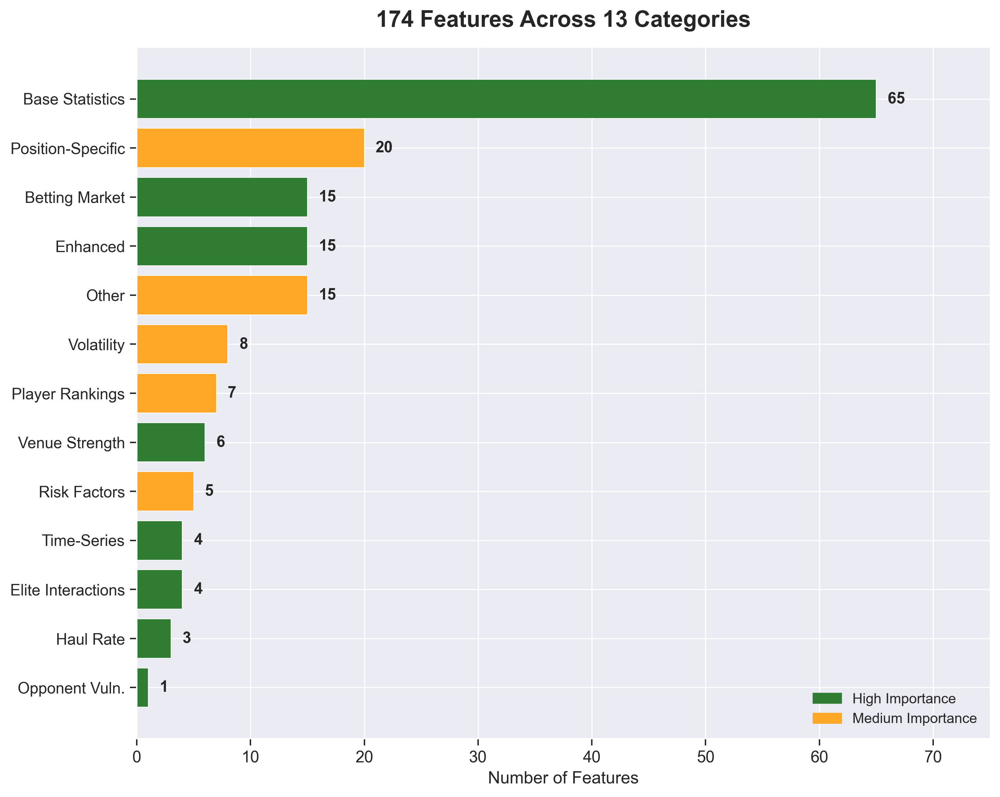
*174 features across 13 categories. Green = high importance features, orange = medium importance.*

### The Magnificent Seven: Features That Actually Matter

I ran three independent importance analyses: Mean Decrease Impurity (MDI), Permutation Importance, and SHAP values. Seven features were in the top 10 for all three methods, with strong agreement on relative importance:

| Rank | Feature | Signal Strength | Why It Matters |
|------|---------|------------|----------------|
| 1 | **points_per_pound** | High | Value efficiency beats raw talent. A £6m player with 5 xP > £12m player with 8 xP for squad building. |
| 2 | **ewm_5gw_points** | Medium-High | Exponentially weighted form. Last 2 games matter **2x more** than games 4-5 weeks ago. |
| 3 | **value_vs_position** | Medium-High | Positional context. A 4-point defender means something different from a 4-point forward. |
| 4 | **clean_sheet_potential** | Medium | Defensive security matters as much as attacking returns for DEF/GKP. |
| 5 | **cs_x_minutes** | Medium | Clean sheet probability × minutes = defensive ceiling. |
| 6 | **rolling_5gw_minutes** | Medium | Playing time is destiny. No minutes, no points. |
| 7 | **rolling_5gw_ict_index** | Medium | ICT captures overall involvement: goals, assists, threat, creativity. |

> **Key insight**: If I had to rebuild with a minimal set, these seven features would be my starting point.

The top 3 features account for 39% of total importance. The model cares mostly about *value efficiency and momentum*.

### What Surprised Me: The Underperformers

Several feature categories I expected to be important... weren't:

| Feature Category | Expected Rank | Actual Rank | What Happened |
|------------------|---------------|-------------|---------------|
| **Betting Odds** | Top 20 | #40-70 | Model learns fixture quality from base stats; doesn't need market odds |
| **Haul Rates** | Top 20 | #100-120 | Current form beats historical haul patterns |
| **Elite Interactions** | Top 20 | #44-138 | Premium players don't respond uniquely to fixtures; they just scale with price |
| **Opponent Vulnerability vs Top 6** | Top 20 | #63-92 | Generic fixture difficulty works just as well |

Even more annoyingly: 35 features had 0.0 importance in all three methods. These include all venue-specific features, all ranking features, and all fixture run projections (3GW, 5GW lookahead).

**Practical implication**: I can probably remove ~20% of features (174 → 139) with minimal impact. An ablation study must confirm this first.

### SHAP Reveals the Non-Linear Truth

SHAP dependence plots show relationships that linear models and simple rules cannot capture.

#### Finding 1: Elite Players Are Fixture-Proof

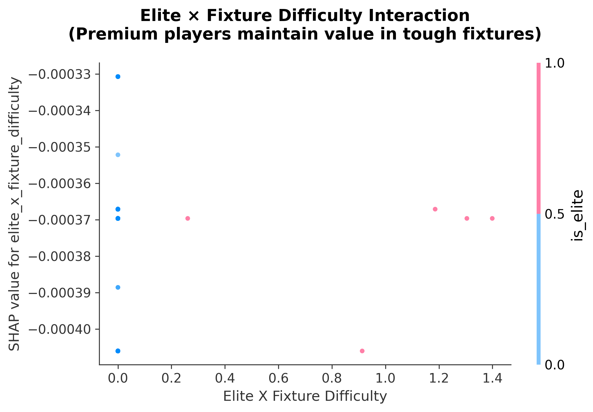
*SHAP dependence plot showing elite player (£10m+) performance across fixture difficulty levels.*

Conventional FPL wisdom treats tough fixtures as near-automatic blanks. Managers often bench players against top-6 teams. The SHAP analysis shows a more nuanced result:

- **Premium players (£10m+)** lose only **20% of their ceiling** in hard fixtures
- Elite players maintain SHAP values of +0.1 to +0.3 even against top defences
- The penalty is steepest at *mid-range* difficulty (2.5-3.5), not at extremes

**Example**: The model predicts 8.2 xP for a premium striker against a top-6 defence, and 10.1 xP in an easy fixture. This is a 19% drop, not the dramatic reduction that conventional wisdom suggests.

> **Strategic implication**: Hold premium assets through 2-3 tough fixtures; their floor remains high.

#### Finding 2: Form Amplifies Fixture Quality

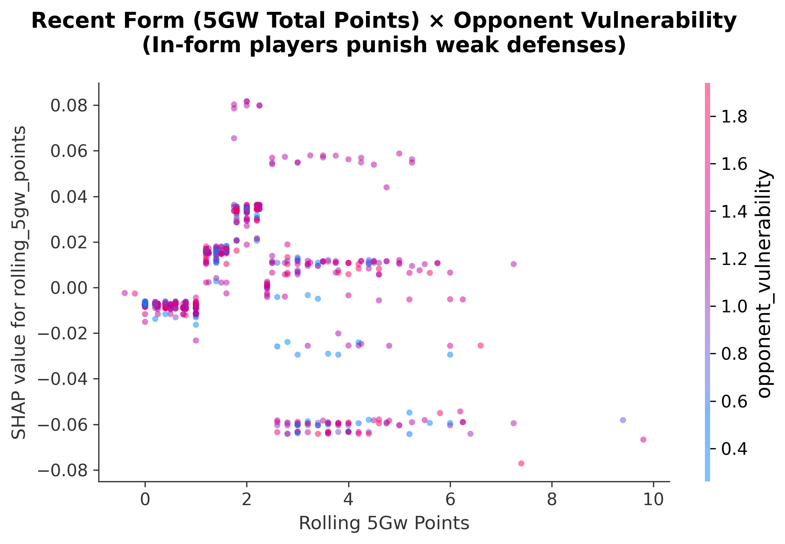
*SHAP dependence plot showing recent form × opponent vulnerability interaction.*

The relationship between form and fixture isn't additive; it's **multiplicative**:

| Form (5GW points) | Weak Opponent | Strong Opponent | Ratio |
|-------------------|---------------|-----------------|-------|
| 35+ pts | +2.0 to +3.0 SHAP | +0.5 to +1.0 SHAP | **3x boost** |
| 25-35 pts | +0.5 to +1.0 SHAP | -0.5 to +0.5 SHAP | 2x boost |
| <25 pts | -0.5 to +0.5 SHAP | -1.5 to -0.5 SHAP | 1.5x penalty |

> **Strategic implication**: The upside is real, but it is rarely free. When form is obvious, prices and ownership change quickly. The edge is in early momentum, not in buying after the crowd.

#### Finding 3: Budget Players Are Fixture-Dependent

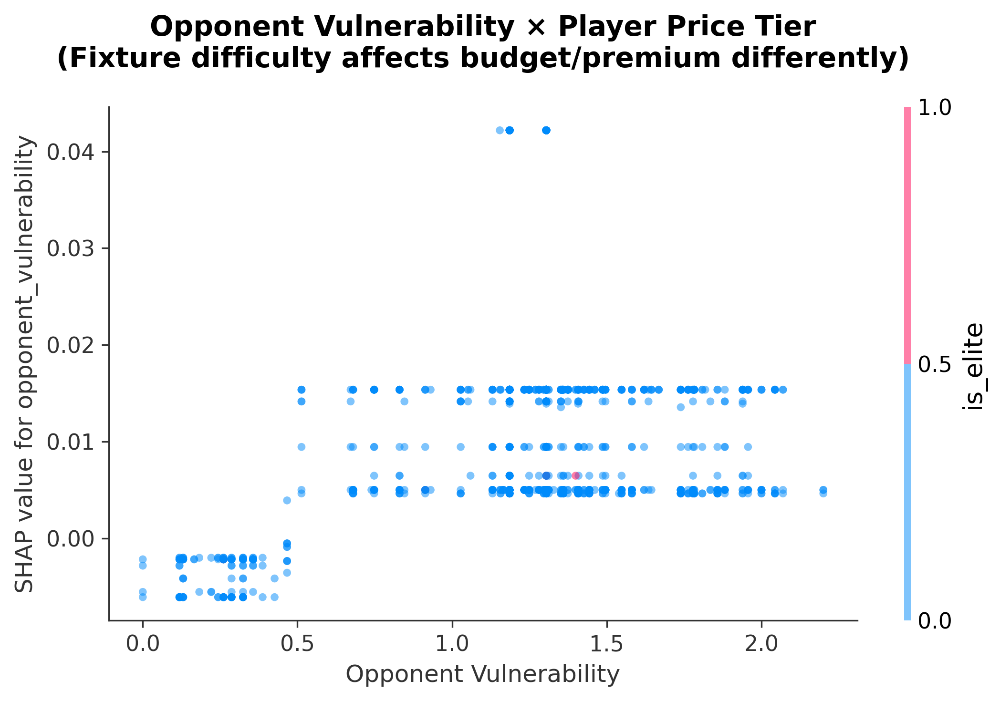
*SHAP dependence plot showing opponent vulnerability × price tier interaction.*

SHAP spread by price tier:

- **Budget players (£4m-£7m)**: SHAP ranges from -1.0 to +1.5 (2.5 unit swing)
- **Elite players (£10m+)**: SHAP ranges from +0.1 to +1.0 (0.9 unit swing, always positive)

> **Strategic implication**: Rotate budget picks based on fixture runs; set-and-forget premiums.

---

## Section 2: The Training Pipeline

### Two Phases: Evaluate, Then Retrain

The training pipeline has two phases:

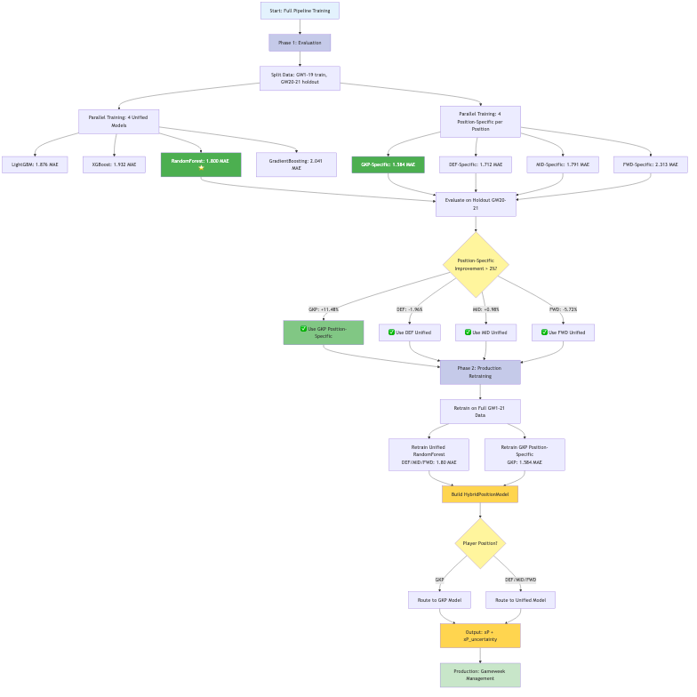

*Full training pipeline, from data split to production.*

**Phase 1: Evaluation** (GW1-19 training, GW20-21 holdout)
- Train 4 unified models in parallel (RandomForest, LightGBM, XGBoost, GradientBoosting)
- Train 4 position-specific models per position (16 total)
- Evaluate on holdout with walk-forward validation
- Decision: Which positions benefit from specialisation?

**Phase 2: Production** (GW1-21 full training)
- Retrain selected models on all available data
- Build HybridPositionModel router
- Deploy with position-based prediction routing

> **Note on architecture selection**: The pipeline evaluates the architectures again each gameweek. The hybrid configuration here (GKP position-specific, others unified) is from one training run. Next week, a different configuration can be better. Treat this as *one valid configuration*, not *the* optimal one.

### Why GKP Gets Its Own Model (This Week)

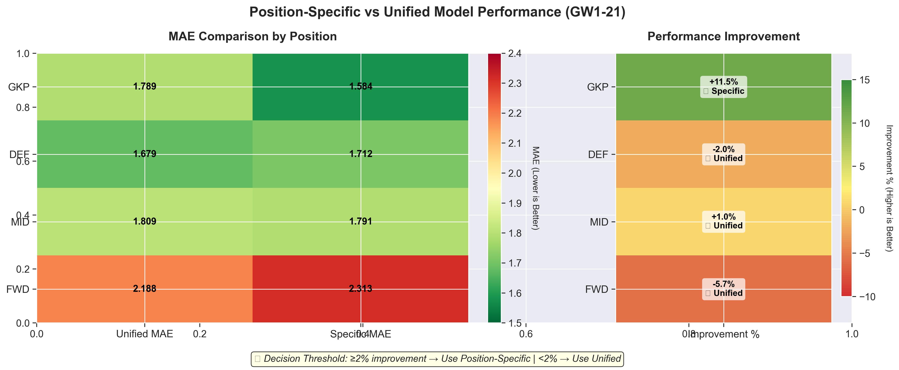
*Position-specific vs unified model performance.*

| Position | Unified MAE | Specific MAE | Improvement | Decision |
|----------|-------------|--------------|-------------|------------|
| **GKP** | 1.789 | 1.584 | **+11.48%** | Use Specific |
| DEF | 1.679 | 1.712 | -1.96% | Use Unified |
| MID | 1.809 | 1.791 | +0.98% | Use Unified |
| FWD | 2.188 | 2.313 | -5.72% | Use Unified |

Only goalkeepers show significant improvement with position-specific modelling. Why?

**GKP scoring is fundamentally different**:
- Clean sheets: 4 points (major contributor)
- Saves: 1 point per 3 saves (variable across GKs)
- Other positions: Goals/assists dominate

The unified model learns one pattern for all positions, but GKPs are outliers. Position-specific features such as `saves_x_opposition_xG` and `clean_sheet_potential` capture details that the unified model misses.

**Threshold decision**: I require ≥2% improvement to justify the complexity of a specialised model. Only GKP meets this bar.

### Model Selection: RandomForest Wins (This Week)

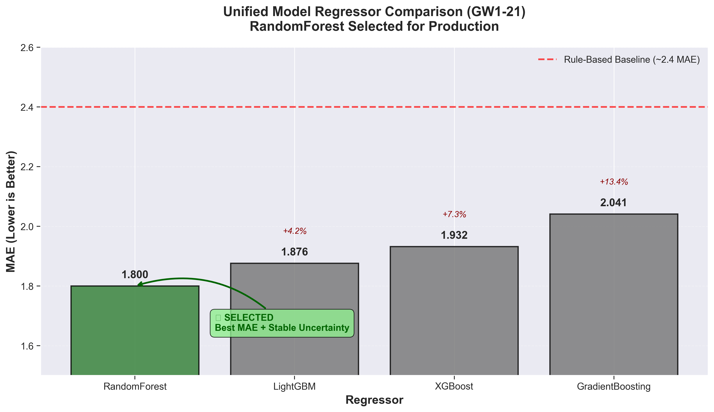
*Cross-validation MAE by regressor.*

| Rank | Regressor | MAE | vs RandomForest |
|------|-----------|-----|-----------------|
| 1 | **RandomForest** | 1.800 | — (selected) |
| 2 | LightGBM | 1.876 | +4.2% |
| 3 | XGBoost | 1.932 | +7.3% |
| 4 | GradientBoosting | 2.041 | +13.5% |
| — | Rule-based baseline | ~2.7 | +33% |

**What is the rule-based baseline?** Before the ML pipeline, I used a heuristic model: 70% recent form (last 5 gameweeks) and 30% season average, multiplied by team strength and fixture difficulty. It has no learned parameters, only hand-tuned coefficients from FPL domain knowledge. It is a sanity check: if the ML model cannot beat simple heuristics, the added complexity is not justified.

RandomForest gives the best MAE. Its ensemble variance also gives a dispersion signal, which helps to find high-ceiling players for captaincy.

### Validation Methodology: The Numbers Behind the Numbers

Walk-forward validation simulates real-world use: train on past data, then predict future gameweeks. This prevents look-ahead bias, which inflates metrics in standard cross-validation.

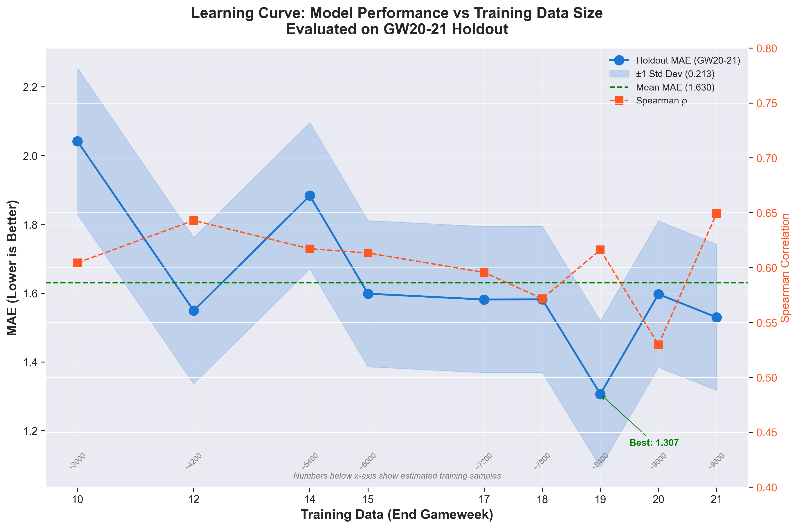
*Learning curve: MAE on the GW20-21 holdout as training data increases. Variability across training sizes comes from different hyperparameter configurations per experiment.*

| Training Data | Holdout MAE | Spearman | Notes |
|---------------|-------------|----------|-------|
| GW1-10 | 2.04 | 0.60 | Insufficient data |
| GW1-12 | 1.55 | 0.64 | Improvement with more data |
| GW1-14 | 1.88 | 0.62 | Variance in HPO |
| GW1-17 | 1.58 | 0.60 | Stabilising |
| GW1-19 | 1.31 | 0.62 | **Production model** |
| GW1-21 | 1.53 | 0.65 | Full season data |

**Key observations:**
- MAE variance across training sizes: ±0.25 (not stable)
- The GW1-19 model shows the best holdout performance, possibly due to favourable hyperparameter search
- More training data does not always improve performance; model configuration is more important

This variability is important context for the headline numbers. The 1.31 MAE is not guaranteed. It is one point in a distribution of possible results.

---

## Section 3: Why Tree Models Win

FPL prediction is a tree-friendly problem, for three reasons:

### 1. Non-Linear Interactions Everywhere

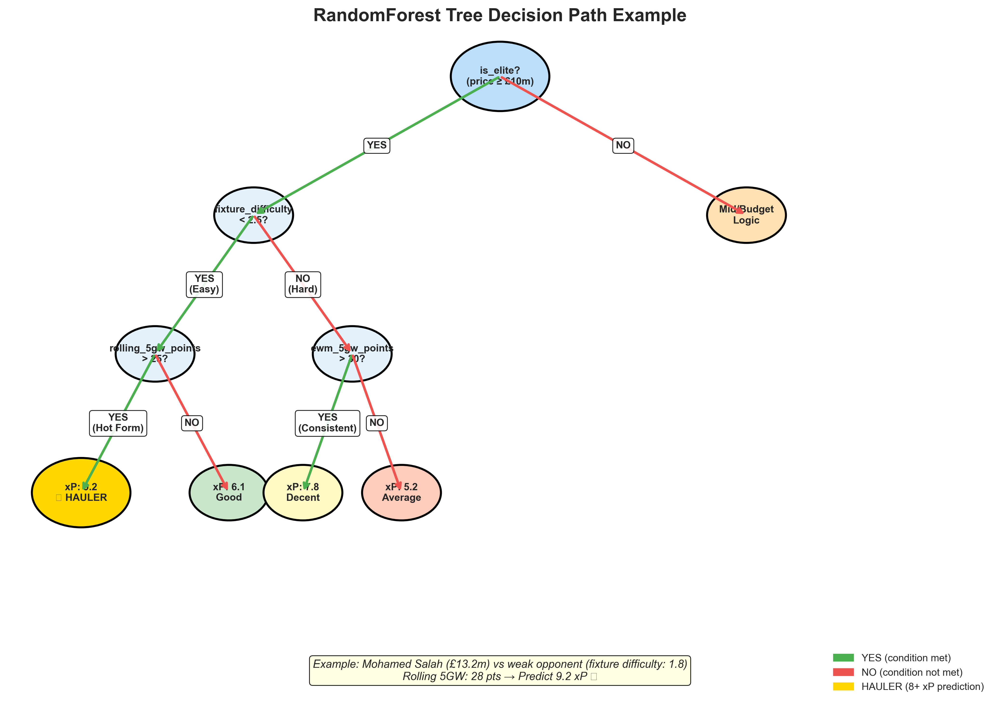
*Example decision path for a hauler prediction. RandomForest checks elite status, fixture difficulty, and recent form to predict 9.2 xP for Haaland against a weak opponent.*

Trees naturally capture interactions that linear models miss:
- **Elite × Fixture**: Premium players maintain value in tough fixtures
- **Form × Opponent**: Recent form amplifies weak-opponent opportunity
- **Minutes × xG**: 0 minutes equals 0 points (sharp threshold, not gradual)

### 2. Categorical Handling

FPL data is inherently categorical:
- Position (GKP/DEF/MID/FWD) has fundamentally different scoring
- Team strength (20 teams, non-ordinal relationships)
- Opponent matchups (categorical fixture interactions)

Trees handle this natively. Linear models need extensive one-hot encoding and lose interaction effects.

### 3. Custom Objectives for Hauler Identification

Standard MAE treats all errors the same. But in FPL, a missed 15-point haul costs more than an overestimated 2-point blank.

I implemented an asymmetric loss function for LightGBM: **2x penalty for under-predicting haulers (10+ points)**. This teaches the model to prioritise hauls.

---

## Section 4: Results

### Production Performance

Evaluated on GW20-21 holdout (n=1,585 predictions, model trained on GW1-19):

| Metric | ML Model | Baselines | Context |
|--------|----------|-----------|---------|
| MAE | 1.31 | Rule-based: ~2.7 | 51% lower error |
| Spearman ρ | 0.62 | — | Moderate rank-order |
| Captain accuracy | 0/2 GWs (0%) | Random: 6.7%, Highest-owned: ~25% | See limitations below |
| Hauler precision@15 | 20% | Aspirational: 50-70% | Gap addressed in limitations |

### Per-Gameweek Breakdown

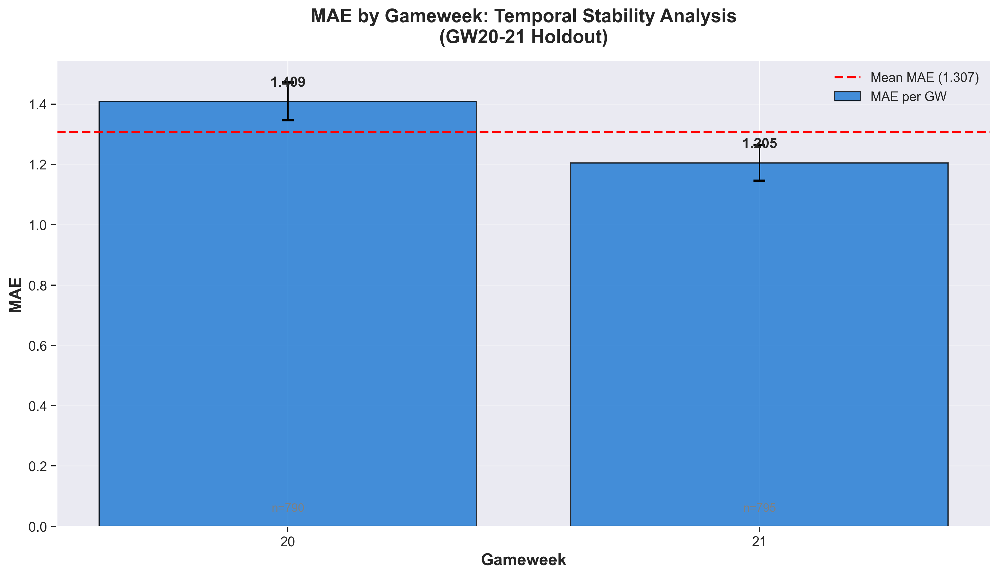
*MAE by gameweek on the holdout set: ~15% variance between gameweeks.*

| Gameweek | MAE | Spearman | Captain Correct | Haulers Found |
|----------|-----|----------|-----------------|---------------|
| GW20 | 1.41 | 0.59 | ❌ | 3/15 (20%) |
| GW21 | 1.21 | 0.64 | ❌ | 2/12 (17%) |

The model missed the top captain pick in both holdout gameweeks.

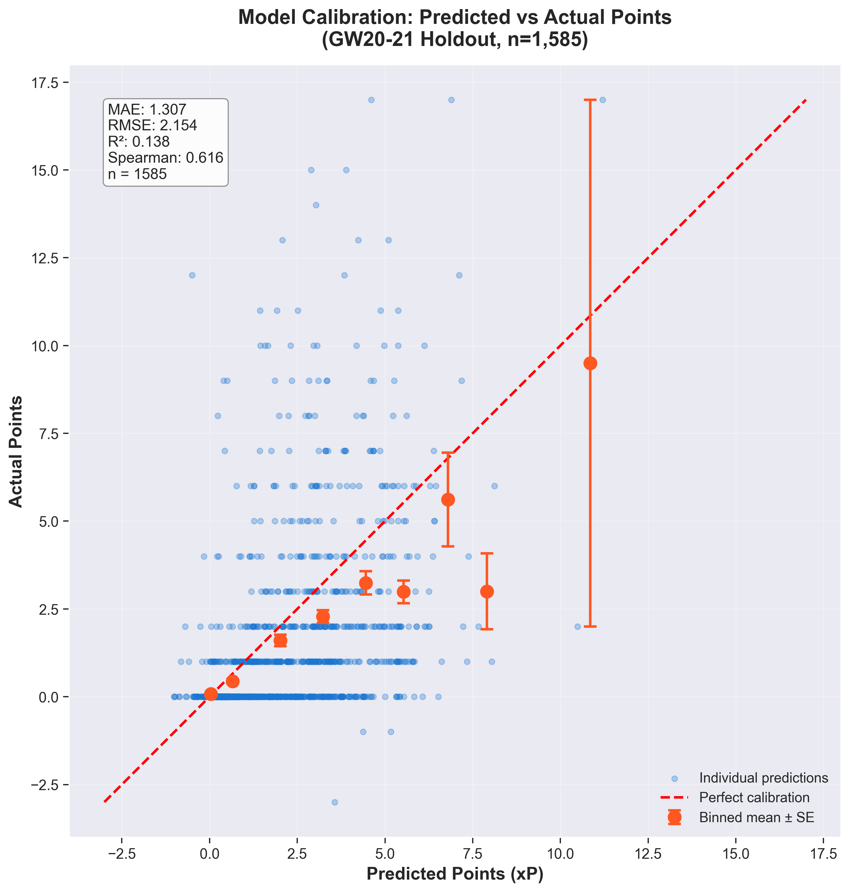
*Calibration plot: predicted vs actual points. Binned means (orange) stay near the 45° line, so predictions are calibrated across the range.*

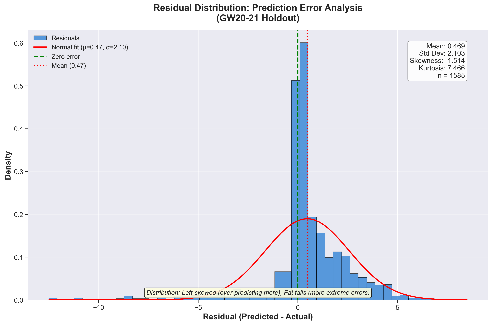
*Residual distribution: errors are approximately symmetric around zero, with a slight right skew (the model under-predicts more often than it over-predicts).*

---

## Limitations & Where the Model Fails

Not every metric tells a success story.

### The Honest Numbers

On the GW20-21 holdout set:

| Metric | Aspirational | Actual | Gap |
|--------|----------|--------|-----|
| Top-15 overlap | 12-13/15 (80%) | 1.7/15 (11%) | **-69%** |
| Captain accuracy | 40%+ | 0/2 (0%) | **-40%** |
| Hauler precision@15 | 50-70% | 20% | **-30 to -50%** |

The model is good at ranking (Spearman 0.62-0.65) but bad at identifying the *absolute top* performers. It can say "Ekitiké will outscore Thiago", but not "Ekitiké will be THE top scorer this week."

### Why the Gap?

The model systematically under-predicts high scorers by 5-12 points. Analysis suggests three causes:

1. **Conservative hyperparameters**: max_depth=4 prioritises stability over capturing explosive patterns
2. **MAE-based training**: Even with custom hauler objectives, the loss function doesn't sufficiently reward capturing 15+ point hauls
3. **Rare event problem**: Haulers (10+ points) are ~8% of observations; the model learns the majority pattern

**Note on sample sizes**: Evaluation metrics use player-game rows (thousands of predictions). But for position-specific models, the number of unique players in that position limits the effective diversity. Goalkeepers are a small and behaviourally distinct group. This makes specialised models more fragile and easier to overfit.

### The 35 Zero-Importance Features

The 35 zero-importance features ([see above](#what-surprised-me-the-underperformers)) are still in the model. Why?
1. An ablation study must first confirm that there are no interaction effects
2. Backward compatibility with saved models
3. Some can become predictive with more training data later in the season

This is known technical debt.

### What I'd Do Differently

1. **Quantile regression**: Train separate models for 10th, 50th, 90th percentiles to better capture haul ceiling
2. **Larger hauler penalty**: Increase the asymmetric loss weight from 2x to 5x for missing haulers
3. **Ensemble approach**: Combine ML predictions with ownership-weighted baseline
4. **Feature reduction**: Remove the 35 zero-importance features before the next retraining

---

## Players to Watch

*Based on ML predictions from the GW1-21 model as of January 11, 2026. These are model suggestions, not guarantees.*

### Forwards

| Player | Team | Price | 1GW xP | 3GW xP | Why the Model Likes Them |
|--------|------|-------|--------|--------|--------------------------|
| Watkins | Aston Villa | £8.7m | 6.8 | 16.2 | Strong form momentum + value efficiency |
| Haaland | Man City | £15.1m | 6.2 | 19.0 | Elite status, fixture-proof, 74% owned template |
| Thiago | Brighton | £7.1m | 5.1 | 15.7 | Excellent 3GW projection, differential |
| Mateta | Crystal Palace | £7.6m | 4.9 | 12.6 | Budget premium alternative |

### Midfielders

| Player | Team | Price | 1GW xP | 3GW xP | Why the Model Likes Them |
|--------|------|-------|--------|--------|--------------------------|
| Bruno Guimarães | Newcastle | £7.2m | 7.1 | 15.3 | Top 1GW pick, underpriced for output |
| Rogers | Aston Villa | £7.6m | 5.8 | 14.1 | Form momentum, favourable fixtures |
| Wirtz | Liverpool | £8.2m | 5.7 | 14.4 | Strong 3GW projection |
| Foden | Man City | £8.7m | 5.7 | 15.1 | Elite x fixture interaction positive |
| Bruno Fernandes | Man Utd | £9.1m | 5.6 | 14.1 | Set-piece threat, consistent floor |
| Bowen | West Ham | £7.7m | 5.1 | 15.4 | Good value at price point |

### Defenders

| Player | Team | Price | 1GW xP | 3GW xP | Why the Model Likes Them |
|--------|------|-------|--------|--------|--------------------------|
| Guéhi | Crystal Palace | £5.3m | 5.2 | 12.1 | High clean sheet potential, 40% owned |
| Gabriel | Arsenal | £6.7m | 5.1 | 13.6 | Set-piece threat + clean sheets |
| Van de Ven | Spurs | £4.6m | 4.9 | 13.1 | Excellent value, 28% owned |
| Cash | Aston Villa | £4.8m | 4.7 | 13.2 | Attacking returns potential |
| J.Timber | Arsenal | £6.3m | 4.6 | 12.6 | Premium defence, rotation risk |

### Goalkeepers

| Player | Team | Price | 1GW xP | 3GW xP | Why the Model Likes Them |
|--------|------|-------|--------|--------|--------------------------|
| A.Becker | Liverpool | £5.4m | 4.5 | 11.6 | Top 1GW projection |
| Vicario | Spurs | £4.8m | 4.3 | 12.8 | Strong 3GW projection |
| Verbruggen | Brighton | £4.5m | 4.0 | 11.9 | Budget with upside |
| Raya | Arsenal | £5.9m | 4.0 | 12.8 | Premium defence, 34% owned |

**Disclaimer**: Use with caution 😉.

---

## Conclusion

Building an ML system for FPL meant a move away from “predict the average well” and towards the real decision problem: separate likely hauls from the pack. I’m not there yet. But the pipeline now produces signals that are directionally useful, and the failure modes are now very clear.

This required three design choices:

1. **Domain-aware features** (174 total) to capture things the FPL UI flattens away (exponential form weighting, fixture interactions, market signals). 35 features show zero importance, which is a clear pruning opportunity.

2. **Custom asymmetric loss functions** to penalise missing hauls more than overestimating blanks. This helps, but it is not sufficient: the model still under-predicts the upper tail.

3. **A hybrid architecture** that treats positions differently. The lift is real, but the constraint is equally real: small samples (such as 58 for GKP) make anything position-specific fragile.

**What worked:**

- Ranking quality (Spearman ~0.62): good enough for selection/portfolio construction

- Clear value signals (`points_per_pound` dominates)

- Clarity on what matters, from a three-method importance analysis

**What didn’t (yet):**

- Captain choice (0% on holdout)

- Top-15 identification (11% overlap vs ~80% target)

- Hauler capture (20% precision vs 50–70% target)

The model is useful for relative ranking. But it is still weak at finding the single highest-ceiling player each week, and that is where FPL points are won.

## From predictions to decisions

Even with a better model, team selection is an optimisation problem with hard constraints. This post stops at ranking and signal generation by design.

The optimiser does the next step: simulated annealing turns noisy model outputs into squad and captaincy decisions within real FPL constraints (budget, positions, and risk appetite). The [first post in this series](/insights/2026-01-02-fpl-first-post/) shows it in action.

---

*Model: GW1-21 Hybrid (RandomForest unified + GKP position-specific)*
*Season: 2025-26 FPL*
