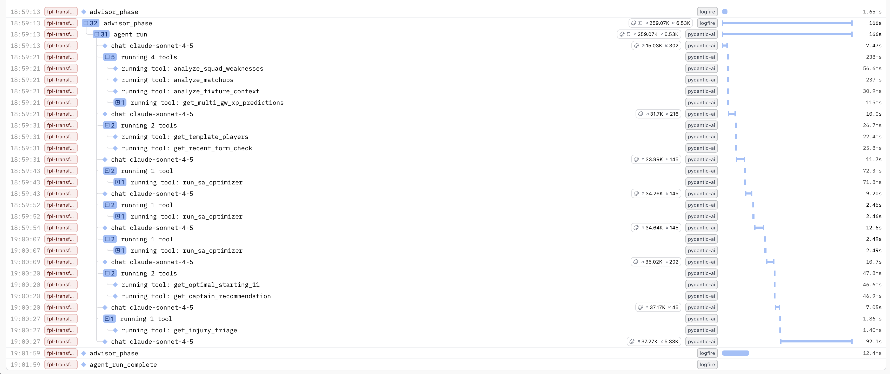
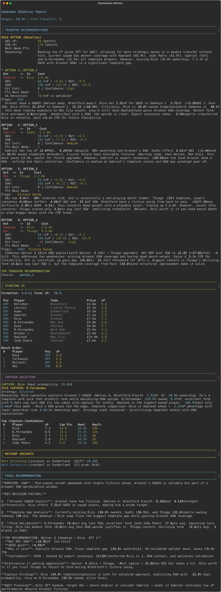
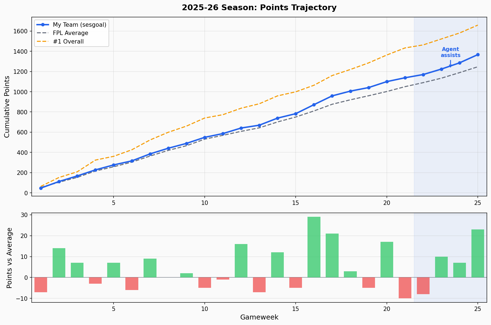

*An ML model can rank players. An optimiser can crunch numbers. But neither can read a press conference.*

*~12 min read*

---

**What's this about?** I'm building a system that plays [Fantasy Premier League](https://fantasy.premierleague.com/): a game where 11 million people pick squads of real footballers and get points for their real-world performances. [Post 1](/insights/2026-01-02-fpl-first-post/) covered why I'm doing this (and why I'm still not winning). [Post 2](/insights/2026-01-11-fpl-ml-pipeline/) built an ML model that is good at ranking players but bad at decisions. This post is about the most interesting part: an AI agent that reasons about *which transfers to make and when*. It considers injuries, fixture swings and chip timing, which the model cannot see.


## tl;dr

An ML model ranks players; an agent decides which transfers to make. The agent adds contextual reasoning to a 178-feature model, validates its recommendations with a mathematical optimiser, and runs on Claude Haiku or Sonnet.

---

## 1. Why ML Predictions Aren't Enough

The [ML model](/insights/2026-01-11-fpl-ml-pipeline/) predicts the points of each player for next week. It ranks players reliably, but ranking is not deciding.

The model uses only Premier League statistics and betting odds. It has no signal from Champions League fixtures, FA Cup replays or international breaks. It does not read press conferences. It cannot detect tactical shifts or dressing-room dynamics. It does not know about mid-season transfers until the data catches up.

When Semenyo moved to City in the January window, he was immediately effective in a superior attacking system. The model needed two gameweeks of City-context data before recognising it. FPL experts had him in their squads the day the transfer was announced.

This pattern repeats often. FPL experts outperform the model without necessarily using quantitative methods. There is clearly signal that the model does not capture.

An agent fills this gap: it adds contextual reasoning and multi-gameweek planning to the ML signal. The engineering problem: LLMs hallucinate, and FPL has hard constraints (budget caps, position requirements, max three players per team). How do you get reliable structured output from an unreliable reasoner? This post gives four answers: typed dependencies, pre-computed tools, modular prompts and a mathematical checker.

---

## 2. Architecture Overview



*Data flows left to right: CLI fetches 15 datasets into AgentDeps, the agent reasons with 10 tools, and outputs a typed GameweekRecommendation.*

The system follows what Google's ["Developer's guide to multi-agent patterns in ADK"](https://developers.googleblog.com/en/developers-guide-to-multi-agent-patterns-in-adk/) (Dec 2025) calls the "coordinator/dispatcher" pattern: a central agent sends tasks to specialised tools, not to peer agents. The pipeline:

```
CLI → DataOrchestrationService → AgentDeps → Pydantic AI Agent → 10 Tools → GameweekRecommendation
```

**Why Pydantic AI?** It is lightweight: typed dependencies via generics (`RunContext[AgentDeps]`), structured output validation with automatic retries, and no unnecessary abstractions. A single-agent system with well-defined tools does not need the layers that heavier frameworks add.

The central design decision is `AgentDeps` as "world state." The system injects all data once, at construction. Each tool reads from deps and does not fetch its own data. This makes testing easy: mock the dependencies, then test the tool logic.

```python
# agent_tools.py:258
class AgentDeps:
    """Dependencies injected into agent tools."""

    def __init__(
        self,
        players_data: pd.DataFrame,
        teams_data: pd.DataFrame,
        fixtures_data: pd.DataFrame,
        live_data: pd.DataFrame,
        ownership_trends: pd.DataFrame | None = None,
        value_analysis: pd.DataFrame | None = None,
        fixture_difficulty: pd.DataFrame | None = None,
        betting_features: pd.DataFrame | None = None,
        player_metrics: pd.DataFrame | None = None,
        player_availability: pd.DataFrame | None = None,
        team_form: pd.DataFrame | None = None,
        players_enhanced: pd.DataFrame | None = None,
        xg_rates: pd.DataFrame | None = None,
        free_transfers: int = 1,
        budget_available: float = 0.0,
        prediction_loader: "PredictionLoaderService | None" = None,
        target_gameweek: int | None = None,
        force_on_the_fly: bool = False,
        ml_model_path: str | None = None,
        prediction_limit: int = 100,
    ):
```

That's 13 DataFrames and 7 scalar parameters: the complete world the agent reasons about. `prediction_limit: int = 100` exists because early runs sent 700+ players and the agent lost focus.

---

## 3. Tool Design: The Agent-Computer Interface

The most important engineering decision in an agent system is which tools to give it. Anthropic's ["Writing Tools for Agents"](https://www.anthropic.com/engineering/writing-tools-for-agents) (Dec 2025) codified ACI (Agent-Computer Interface) principles. They match the patterns I had already found.

The system started with 5 tools. It grew to 10 when the agent hit edge cases it could not handle. The tools are in three categories:

| Category | Tool | Purpose |
|----------|------|---------|
| **Data retrieval** | `get_multi_gw_xp_predictions` | 1/3/5 GW ML forecasts (top 100 players) |
| | `get_recent_form_check` | Validate xP vs actual recent points |
| | `get_injury_triage` | Classify injuries: must-sell vs bench vs monitor |
| **Analysis** | `analyze_fixture_context` | DGWs, BGWs, fixture swings |
| | `analyze_squad_weaknesses` | Find upgrade targets (xP < 3.0, injury < 75%) |
| | `analyze_matchups` | Strength differentials, xG, win probability |
| | `get_template_players` | Ownership consensus, template coverage gaps |
| **Action** | `run_sa_optimizer` | SA validation (max 3 calls per run) |
| | `get_captain_recommendation` | Haul probability, ownership safety |
| | `get_optimal_starting_11` | Formation optimisation from 15-player squad |


*Logfire span tree from a real run. The LLM decides the tool order; it is not hardcoded. The agent usually follows the workflow in the system prompt, but adapts to context (e.g., it skips injury triage when no injuries are flagged).*

### Design principles

**Return high-signal summaries, not raw data.** Anthropic's guidance: "return information, not raw IDs." No DataFrames ever appear in tool returns. `analyze_squad_weaknesses` returns "upgrade targets with xP gap", not player stat tables. `analyze_matchups` returns "best attacking matchup: City vs Forest, strength_diff=0.6", not a fixture difficulty matrix. Tools convert pandas results to JSON-serializable dicts before returning.

**Docstrings are API contracts.** Each docstring includes examples, edge cases, and performance hints. When the agent misused a tool, the fix was usually a better docstring or restructured output, not a prompt change. This matches Anthropic's guidance to iterate on the tool interface, not just the prompt.

**Consolidate related operations.** `analyze_squad_weaknesses` combines injury checks, xP analysis, and ownership data in a single call instead of requiring three separate tool invocations. Fewer calls means fewer tokens on tool-call overhead, and less risk that the agent loses its thread between calls.

**Cap expensive operations.** Two mechanisms keep token budgets under control. First, the prompt guides the agent to a maximum of 3 SA calls per run. Without this limit, the agent calls SA for every speculative scenario. The limit forces it to reason first and validate only its top candidates. Second, the prediction limit sends ML forecasts for only the top 100 players by xP. All 700+ players would blow the context budget and not improve decisions.

```python
# agent_tools.py:1140
def run_sa_optimizer(
    ctx: RunContext[AgentDeps],
    current_squad_ids: list[int],
    num_transfers: int,
    target_gameweek: int,
    horizon: int = 3,
    must_include_ids: list[int] | None = None,
    must_exclude_ids: list[int] | None = None,
) -> Dict[str, Any]:
    """
    Run Simulated Annealing optimizer for validation/benchmarking.

    Use this tool to validate your transfer recommendations against the SA
    optimizer's mathematically optimal solution. The optimizer searches
    thousands of combinations to find the highest xP squad within
    constraints over the specified horizon.

    IMPORTANT: Call this tool AFTER generating your candidate scenarios
    to validate them, not BEFORE. The agent should reason first, then
    validate.

    Returns:
        {
            "optimal_squad_ids": [1, 2, 3, ...],  # 15 player IDs
            "transfers": [...],
            "expected_xp": 65.3,
            "xp_gain": 4.2,
            "hit_cost": -4,
            "net_gain": 0.2,
            "free_transfers_used": 1,
            "runtime_seconds": 12.4,
            "formation": "4-4-2"
        }
    """
```

---

## 4. Context Engineering: Beyond Prompt Tuning



*Agent output for a real gameweek: transfer scenarios with SA validation, starting XI, captain recommendation. Colour-coded Rich console panels make the output easy to scan.*

I've started thinking about this less as prompt engineering and more as [context engineering](https://www.anthropic.com/engineering/effective-context-engineering-for-ai-agents), which Anthropic defines as "curating the optimal set of tokens during inference." The aim: "find the smallest set of high-signal tokens." The system prompt is one input; the full context strategy also manages tool outputs, external data injection, and context trimming.

| Context layer | Mechanism | Token impact |
|---------------|-----------|--------------|
| **System prompt** | 13 modular components via `.format()` | ~2,000 tokens (stable) |
| **Tool output formatting** | Structured JSON summaries, not raw data | Controlled per tool |
| **Expert consensus injection** | ~200 tokens, just-in-time in user prompt | ~200 tokens |
| **Prediction limit** | Top 100 players, not 700+ | Saves ~60K tokens |
| **SA feedback loop** | Optimiser results feed back into reasoning | ~500 tokens per call |

### The prompt layer: 13 modular components

The system prompt assembles from 13 independent components via `.format()`. Each component is a separate constant: testable, swappable, versionable.

```python
# transfer_planning_agent_service.py:1020
system_prompt = GAMEWEEK_ADVISOR_SYSTEM_PROMPT.format(
    target_gw=target_gameweek,
    strategy_mode=strategy_mode.value,
    strategy_one_liner=strategy_one_liner,
    horizon_selection=HORIZON_SELECTION,
    workflow=GAMEWEEK_ADVISOR_WORKFLOW,
    matchup_rules=GAMEWEEK_ADVISOR_MATCHUP_RULES,
    captain_safety=CAPTAIN_SAFETY_RULES,
    chip_awareness=CHIP_AWARENESS_RULES,
    expert_consensus=EXPERT_CONSENSUS_RULES,
    field_mapping=FIELD_MAPPING_INSTRUCTIONS,
    roi_calculation=roi_calc_formatted,
    common_mistakes=mistakes_formatted,
    thinking_instructions=THINKING_INSTRUCTIONS,
)
```

Five components are worth detailing:

- **Horizon selection** forces the agent to decide between 1-gameweek and 3-gameweek horizons *before* evaluating transfers, with explicit trigger conditions (DGW forces 1GW, protecting rank forces 3GW). This prevents post-hoc rationalisation.
- **ROI calculation rules** include concrete worked examples with actual numbers ("Watkins 4.2 xP/3GW to Haaland 11.8 xP/3GW, net_roi = 7.6 - 4 = 3.6") because LLMs are bad at arithmetic. Examples in the correct format greatly reduce calculation errors.
- **Common mistakes** lists 12 explicit "don't do this" items. Each item comes from a real agent failure. For example, early runs recommended selling an injured player who was out for only 1-2 weeks. This used a transfer, when the user could bench the player through a tough fixture. That failure became the rule "Selling injured player who may return in 1-2 weeks: short-term injuries -> bench; only sell if FT would otherwise go to waste." Negative examples are more effective than positive instructions for LLMs.
- **Structured thinking format** requires a `<decision>` block before output. This makes the reasoning visible (horizon choice, hold baseline, best scenario, net ROI, justification) and debugging easy.
- **Field mapping instructions** prevent field hallucination by explicitly mapping output fields to tool outputs; without this, the agent invents field names or omits required fields.

Modularity pays off. For a new class of error, I add one rule to `COMMON_MISTAKES` and change nothing else. The prompt grew from 5 to 13 components in 3 months, and the template never needed restructuring.

### Injecting external context

Two sources give the agent context beyond ML predictions. `XPCalibrationService` applies additive corrections from historical (price tier x fixture difficulty) residuals. For example, a mid-price midfielder against a bottom-3 defence gets +0.4 xP. This prevents model overconfidence on tough fixtures and underconfidence on easy ones.

`ExpertConsensusService` fetches the picks of 10 top FPL managers from the public API. It compresses them to ~200 tokens and injects them into the user prompt: "Most owned: Haaland (10/10), Semenyo (9/10), Jo&atilde;o Pedro (8/10)." Expert consensus catches what the model misses: AFCON call-ups, behind-the-scenes rotation, the "smart money" signal. The prompt explicitly frames it as supplementary validation, not a replacement for xP analysis.

---

## 5. The Validation Loop: SA Optimiser as Checker



*The agent is the strategist; SA is the accountant. Small sa_deviation means high confidence. Large deviation forces the agent to justify or adopt SA's pick.*

I got the idea from Anthropic's ["Building Effective Agents"](https://www.anthropic.com/research/building-effective-agents): use a checker, not just a generator. The agent proposes transfer scenarios; the SA optimiser validates them mathematically. This is the generator-checker pattern applied to constrained optimisation.

In standard agent architectures, the "reflection pattern" has the LLM critique its own output before finalising. My version replaces LLM self-critique with a mathematical optimiser, which works better when "correct" has a precise definition.

The flow in practice:

1. Agent reasons about squad weaknesses, fixtures, form
2. Agent proposes 3-5 transfer scenarios with xP estimates
3. Top 2-3 scenarios get validated via `run_sa_optimizer`
4. SA returns the mathematically optimal squad for that transfer count
5. `sa_deviation` captures how far agent reasoning diverged from the optimum

```python
# From TransferScenario (transfer_recommendation.py:182)
sa_validated: bool = Field(
    False, description="Whether SA optimizer validated this scenario"
)
sa_deviation: float | None = Field(
    None, description="xP difference vs SA solution (+/- xP)"
)
```

Small deviation (< 1.0 xP): agent reasoning aligns with math; high confidence. Large deviation (> 3.0 xP): the agent likely hallucinated a player's xP or miscalculated budget. For example, the agent says "DGW next week, we should target City assets." SA replies "here's the mathematically best way to do that within budget."

In practice, the checker stops scenarios with budget violations or invalid transfers before they reach the user. The agent's hold-vs-transfer reasoning improved when it could compare against the SA baseline. SA's `optimal_squad_ids` also go directly into starting XI selection, so no manual calculation is necessary. The SA checker is the highest-ROI decision in the system: it turned a "sometimes right" system into a "verifiably correct" one.

---

## 6. Structured Output and Error Recovery

Pydantic AI's structured output with `output_retries=3` handles the "unreliable reasoner" problem. When the agent gives invalid output, the retry sends the validation error as feedback. The agent corrects itself from Pydantic's error messages (e.g., "field 'captain_id' required").

The output model, `GameweekRecommendation`, is deeply nested:

- `HoldOption`: baseline no-transfer scenario
- `List[TransferScenario]`: 3-5 ranked options with SA validation fields
- `StartingXIRecommendation`: 11 starters + 4 bench with typed `StartingPlayer`/`BenchPlayer`
- `CaptainRecommendation`: captain + vice + top 5 candidates with haul probabilities
- `MatchupSummary`: attacking/defensive matchups, avoid list

Every field has `Field(description=...)` to guide the LLM's output. Strict validation like `min_length=11, max_length=11` on `starting_11` catches malformed squads before they reach the user.

Post-processing via `_enrich_gameweek_recommendation()` fixes common LLM output issues: transferred-out players appearing in starting XI (detected and swapped automatically), missing team names looked up from source data, captain candidates enriched with ownership percentages. This is a safety net, not a crutch: the prompt must get it right, and enrichment handles edge cases.

**Cost.** Claude Haiku costs approximately $0.02-0.04 per run (~100K input tokens, ~4K output). Why Haiku and not Sonnet or Opus? The bottleneck is prompt quality and tool design, not model capability. Haiku does the structured reasoning well enough, and the 10-50x cost difference lets me iterate on prompts freely.

**Observability.** Logfire traces three phases: `data_preparation`, `agent_reasoning`, `output_enrichment`. Each run logs its token count:

```python
# transfer_planning_agent_service.py:1133
estimated_cost_usd = (
    total_input_tokens * 0.80 / 1_000_000
    + total_output_tokens * 4.00 / 1_000_000
)
```

---

## 7. Results So Far


*Top: cumulative points trajectory for the season. Bottom: per-gameweek delta vs FPL average. The shaded region marks GW22-25 where the agent has been assisting transfer decisions.*

The agent has helped with transfer decisions since GW22. In those four gameweeks, the team averaged 57.2 points per GW against the FPL average of 49.2. That is a +8.0 delta, approximately double the +4.2 delta before the agent (GW1-21). Overall rank went from ~3.4M at GW21 to ~2.3M at GW25. Four gameweeks is far too small a sample for conclusions, but the early trend is encouraging.

---

## 8. What I'd Do Differently

Invest in evals earlier. At the moment, the system uses only manual, scenario-based tests. Only [52% of organisations run offline evals](https://www.langchain.com/state-of-agent-engineering) (LangChain State of Agent Engineering, 2025); I'm in the other 48%. I want automated regression evals on every prompt change, combining LLM-as-judge (does the reasoning make sense?) with deterministic checks (are constraints satisfied?). The prompt grew to 13 components; without evals, it's hard to know if changing one section regresses another.

---

## 9. Takeaways for Builders

1. **Think context engineering, not prompt engineering.** Tool output formatting, external data injection, context trimming (`prediction_limit=100`) and feedback loops (SA results) are as important as the system prompt. Manage all the tokens the model sees at inference.

2. **Invest in tool design over prompt complexity.** Tools are the stable interface; prompts are the tunable layer. Good tools with a mediocre prompt outperform mediocre tools with a brilliant prompt.

3. **Use a mathematical checker if your domain has hard constraints.** The generator-checker pattern (agent proposes, optimiser validates) is the most useful pattern I found. Budget limits, position requirements, squad rules: check anything with a right/wrong answer in code.

4. **Modular prompts > monolithic prompts.** 13 swappable components beat one 2,000-word blob. Testable, iterable, debuggable. When the agent makes a new error, add one rule.

5. **Inject structured context, not raw data.** The LLM is a reasoner, not a database. Pre-compute summaries in tools; return JSON, not DataFrames.

6. **Start with the cheapest model that works.** Haiku at $0.02-0.04/run. Upgrade for specific scenarios, not as a default. The constraint is usually prompt quality, not model capability.

7. **Cap your context.** 100 players out of 700+, 3 SA calls out of unlimited. Constraints on the agent improve reasoning quality by reducing noise.

---

*Previous: [Predicting Haulers, Not Averages](/insights/2026-01-11-fpl-ml-pipeline/)*
