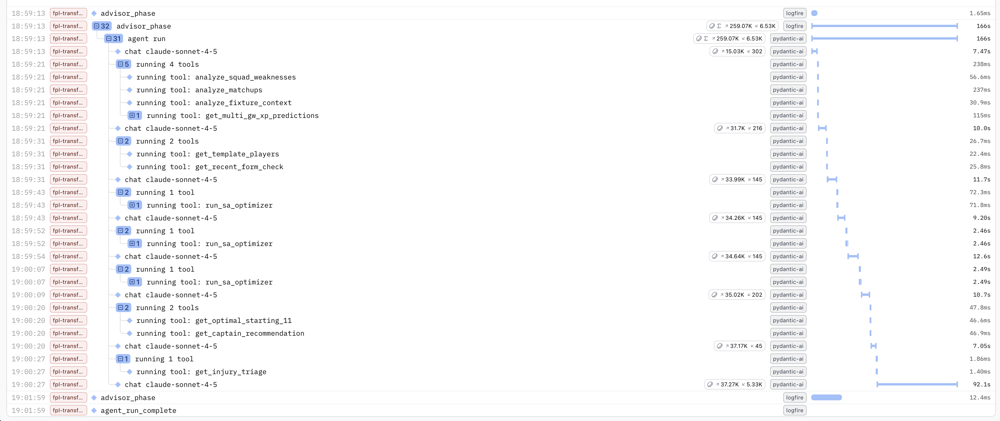
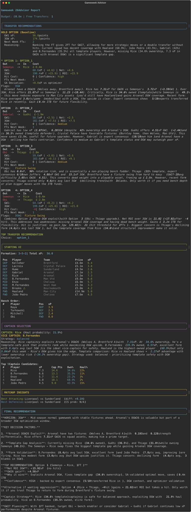
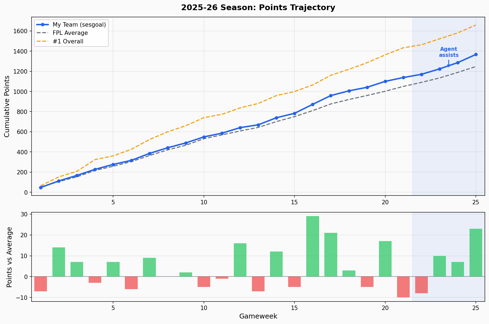

*An ML model can rank players. An optimiser can crunch numbers. But neither can read a press conference.*

*~12 min read*

---

**What's this about?** I'm trying to build a system that can play [Fantasy Premier League](https://fantasy.premierleague.com/) — a game where 11 million people pick squads of real footballers and score points based on their real-world performances. [Post 1](https://alexiospanos.com/why-im-building-in-public-while-losing/) covered why I'm doing this (and why I'm still not winning). [Post 2](https://alexiospanos.com/predicting-haulers-not-averages/) built an ML model that's good at ranking players but bad at making decisions. This post focusses on the most interesting bit: an AI agent that can actually reason about *which transfers to make and when*; factoring in injuries, fixture swings, and chip timing that the model can't see.


## tl;dr

An ML model ranks players; an agent decides which transfers to make. The system layers contextual reasoning on top of a 178-feature model, validates recommendations against a mathematical optimiser, and runs on Claude Haiku or Sonnet.

---

## 1. Why ML Predictions Aren't Enough

In [Part 2](https://alexiospanos.com/predicting-haulers-not-averages/), I built a 178-feature ML model that predicts how many points a player will score next week. It's accurate enough to rank players reliably, but ranking is not deciding.

The predictive model's context is limited to Premier League statistics and betting odds. It has no signal from Champions League fixtures, FA Cup replays, or international breaks. It doesn't read press conferences. It can't detect tactical shifts or dressing-room dynamics. It has no awareness of mid-season transfers until the data catches up.

When Semenyo moved to City in the January window, he was immediately effective in a superior attacking system. The model needed two gameweeks of City-context data before recognising it. FPL experts had him in their squads the day the transfer was announced.

That pattern repeats constantly. FPL experts outperform without necessarily invoking quantitative sophistication. There's clearly signal the model doesn't capture.

This is the gap an agent fills: contextual reasoning and multi-gameweek planning on top of ML signal. The engineering challenge is that LLMs hallucinate, and FPL has hard constraints (budget caps, position requirements, three players per team). How do you get reliable structured output from an unreliable reasoner? This post covers the answer: typed dependencies, pre-computed tools, modular prompts, and a mathematical checker.

---

## 2. Architecture Overview



*Data flows left to right: CLI fetches 15 datasets into AgentDeps, the agent reasons with 10 tools, and outputs a typed GameweekRecommendation.*

The system follows what Google's ["Developer's guide to multi-agent patterns in ADK"](https://developers.googleblog.com/en/developers-guide-to-multi-agent-patterns-in-adk/) (Dec 2025) calls the "coordinator/dispatcher" pattern: a central agent delegates to specialised tools rather than peer agents. The pipeline is straightforward:

```
CLI → DataOrchestrationService → AgentDeps → Pydantic AI Agent → 10 Tools → GameweekRecommendation
```

**Why Pydantic AI?** Lightweight, typed dependencies via generics (`RunContext[AgentDeps]`), structured output validation with automatic retries, and no unnecessary abstractions. I didn't need the layers that heavier frameworks add. For a single-agent system with well-defined tools, Pydantic AI stays out of the way.

The central design decision is `AgentDeps` as "world state." All data is injected once at construction; every tool reads from deps rather than fetching its own data. This makes testing trivial: mock the dependencies, test the tool logic.

```python
# agent_tools.py:258
class AgentDeps:
    """Dependencies injected into agent tools."""

    def __init__(
        self,
        players_data: pd.DataFrame,
        teams_data: pd.DataFrame,
        fixtures_data: pd.DataFrame,
        live_data: pd.DataFrame,
        ownership_trends: pd.DataFrame | None = None,
        value_analysis: pd.DataFrame | None = None,
        fixture_difficulty: pd.DataFrame | None = None,
        betting_features: pd.DataFrame | None = None,
        player_metrics: pd.DataFrame | None = None,
        player_availability: pd.DataFrame | None = None,
        team_form: pd.DataFrame | None = None,
        players_enhanced: pd.DataFrame | None = None,
        xg_rates: pd.DataFrame | None = None,
        free_transfers: int = 1,
        budget_available: float = 0.0,
        prediction_loader: "PredictionLoaderService | None" = None,
        target_gameweek: int | None = None,
        force_on_the_fly: bool = False,
        ml_model_path: str | None = None,
        prediction_limit: int = 100,
    ):
```

That's 13 DataFrames and 7 scalar parameters: the complete world the agent reasons about. Note `prediction_limit: int = 100`; that parameter exists because early runs sent 700+ players and the agent lost focus. More on context management shortly.

---

## 3. Tool Design: The Agent-Computer Interface

The most important engineering decision in any agent system is what tools to give it. Anthropic's ["Writing Tools for Agents"](https://www.anthropic.com/engineering/writing-tools-for-agents) (Dec 2025) codified ACI (Agent-Computer Interface) principles that I found lined up with patterns I'd already landed on. The patterns below map directly to their guidance.

The system started with 5 tools and grew to 10 as the agent hit edge cases it couldn't handle. They group into three categories:

| Category | Tool | Purpose |
|----------|------|---------|
| **Data retrieval** | `get_multi_gw_xp_predictions` | 1/3/5 GW ML forecasts (top 100 players) |
| | `get_recent_form_check` | Validate xP vs actual recent points |
| | `get_injury_triage` | Classify injuries: must-sell vs bench vs monitor |
| **Analysis** | `analyze_fixture_context` | DGWs, BGWs, fixture swings |
| | `analyze_squad_weaknesses` | Find upgrade targets (xP < 3.0, injury < 75%) |
| | `analyze_matchups` | Strength differentials, xG, win probability |
| | `get_template_players` | Ownership consensus, template coverage gaps |
| **Action** | `run_sa_optimizer` | SA validation (max 3 calls per run) |
| | `get_captain_recommendation` | Haul probability, ownership safety |
| | `get_optimal_starting_11` | Formation optimisation from 15-player squad |


*Logfire span tree from a real run. Tool ordering is LLM-decided, not hardcoded; the agent typically follows the workflow in the system prompt but adapts based on context (e.g., skipping injury triage when no injuries are flagged).*

### Design principles

**Return high-signal summaries, not raw data.** Anthropic's guidance: "return information, not raw IDs." No DataFrames ever appear in tool returns. `analyze_squad_weaknesses` returns "upgrade targets with xP gap", not player stat tables. `analyze_matchups` returns "best attacking matchup: City vs Forest, strength_diff=0.6", not a fixture difficulty matrix. Tools convert pandas results to JSON-serializable dicts before returning.

**Docstrings are API contracts.** The docstring IS the interface. It includes examples, edge cases, and performance hints. When the agent misused a tool, the fix was usually a better docstring or restructured output, not a prompt change. This matches Anthropic's guidance to iterate on the tool interface, not just the prompt.

**Consolidate related operations.** `analyze_squad_weaknesses` combines injury checks, xP analysis, and ownership data in a single call instead of requiring three separate tool invocations. Fewer calls means fewer tokens spent on tool-call overhead and less chance of the agent losing its thread between calls.

**Cap expensive operations.** Two mechanisms keep token budgets under control. First, the SA optimiser is guided to 3 calls per run. Without this limit, the agent calls SA for every speculative scenario. The limit forces it to reason first and validate only its top candidates. Second, the prediction limit restricts ML forecasts to the top 100 players by xP. The full player pool is 700+; sending all of them would blow the context budget without improving decision quality.

```python
# agent_tools.py:1140
def run_sa_optimizer(
    ctx: RunContext[AgentDeps],
    current_squad_ids: list[int],
    num_transfers: int,
    target_gameweek: int,
    horizon: int = 3,
    must_include_ids: list[int] | None = None,
    must_exclude_ids: list[int] | None = None,
) -> Dict[str, Any]:
    """
    Run Simulated Annealing optimizer for validation/benchmarking.

    Use this tool to validate your transfer recommendations against the SA
    optimizer's mathematically optimal solution. The optimizer searches
    thousands of combinations to find the highest xP squad within
    constraints over the specified horizon.

    IMPORTANT: Call this tool AFTER generating your candidate scenarios
    to validate them, not BEFORE. The agent should reason first, then
    validate.

    Returns:
        {
            "optimal_squad_ids": [1, 2, 3, ...],  # 15 player IDs
            "transfers": [...],
            "expected_xp": 65.3,
            "xp_gain": 4.2,
            "hit_cost": -4,
            "net_gain": 0.2,
            "free_transfers_used": 1,
            "runtime_seconds": 12.4,
            "formation": "4-4-2"
        }
    """
```

The anti-pattern worth calling out: giving the agent raw data and hoping it figures things out. The LLM is a reasoner, not a database query engine. Pre-compute in tools; return structured summaries.

---

## 4. Context Engineering: Beyond Prompt Tuning



*Agent output for a real gameweek: transfer scenarios with SA validation, starting XI, captain recommendation. The Rich console panels use colour-coded sections that make the structured output scannable.*

I've started thinking about this less as prompt engineering and more as [context engineering](https://www.anthropic.com/engineering/effective-context-engineering-for-ai-agents), which Anthropic defines as "curating the optimal set of tokens during inference." The system prompt is one input; the full context strategy also manages tool outputs, external data injection, and context trimming.

| Context layer | Mechanism | Token impact |
|---------------|-----------|--------------|
| **System prompt** | 13 modular components via `.format()` | ~2,000 tokens (stable) |
| **Tool output formatting** | Structured JSON summaries, not raw data | Controlled per tool |
| **Expert consensus injection** | ~200 tokens, just-in-time in user prompt | ~200 tokens |
| **Prediction limit** | Top 100 players, not 700+ | Saves ~60K tokens |
| **SA feedback loop** | Optimiser results feed back into reasoning | ~500 tokens per call |

Anthropic's framing: "find the smallest set of high-signal tokens." The `prediction_limit=100` parameter is context trimming. Expert consensus injection is just-in-time retrieval. Tool output formatting is context shaping. The system prompt is just the most visible layer.

### The prompt layer: 13 modular components

The system prompt assembles from 13 independent components via `.format()`. Each component is a separate constant: testable, swappable, versionable.

```python
# transfer_planning_agent_service.py:1020
system_prompt = GAMEWEEK_ADVISOR_SYSTEM_PROMPT.format(
    target_gw=target_gameweek,
    strategy_mode=strategy_mode.value,
    strategy_one_liner=strategy_one_liner,
    horizon_selection=HORIZON_SELECTION,
    workflow=GAMEWEEK_ADVISOR_WORKFLOW,
    matchup_rules=GAMEWEEK_ADVISOR_MATCHUP_RULES,
    captain_safety=CAPTAIN_SAFETY_RULES,
    chip_awareness=CHIP_AWARENESS_RULES,
    expert_consensus=EXPERT_CONSENSUS_RULES,
    field_mapping=FIELD_MAPPING_INSTRUCTIONS,
    roi_calculation=roi_calc_formatted,
    common_mistakes=mistakes_formatted,
    thinking_instructions=THINKING_INSTRUCTIONS,
)
```

Five components are worth detailing:

- **Horizon selection** forces the agent to decide between 1-gameweek and 3-gameweek horizons *before* evaluating transfers, with explicit trigger conditions (DGW forces 1GW, protecting rank forces 3GW). This prevents post-hoc rationalisation.
- **ROI calculation rules** include concrete worked examples with actual numbers ("Watkins 4.2 xP/3GW to Haaland 11.8 xP/3GW, net_roi = 7.6 - 4 = 3.6") because LLMs are notoriously bad at arithmetic; giving examples in the right format drastically reduces calculation errors.
- **Common mistakes** lists 12 explicit "don't do this" items, each discovered from a real agent failure and added iteratively. For example, early runs would recommend selling an injured player who was only out for 1-2 weeks, burning a transfer when the user could simply bench them through a tough fixture. That failure became the rule "Selling injured player who may return in 1-2 weeks: short-term injuries -> bench; only sell if FT would otherwise go to waste." Negative examples are more effective than positive instructions for LLMs.
- **Structured thinking format** mandates a `<decision>` block before output, forcing transparent reasoning (horizon choice, hold baseline, best scenario, net ROI, justification) that makes debugging trivial.
- **Field mapping instructions** prevent field hallucination by explicitly mapping output fields to tool outputs; without this, the agent invents field names or omits required fields.

The modularity payoff is real. When the agent makes a new class of error, I add one rule to `COMMON_MISTAKES`; no other changes needed. The prompt grew from 5 to 13 components over 3 months; the template never needed restructuring.

### Injecting external context

Two sources ground the agent beyond ML predictions. `XPCalibrationService` applies additive corrections based on (price tier x fixture difficulty) residuals. A mid-price midfielder against a bottom-3 defence gets a +0.4 xP uplift based on historical residuals. This prevents model overconfidence on tough fixtures and underconfidence on easy ones.

`ExpertConsensusService` fetches picks from 10 top FPL managers via the public API, compressed to approximately 200 tokens and injected into the user prompt: "Most owned: Haaland (10/10), Semenyo (9/10), Jo&atilde;o Pedro (8/10)." Expert consensus catches what the model misses: AFCON call-ups, behind-the-scenes rotation, the "smart money" signal. The prompt explicitly frames it as supplementary validation, not a replacement for xP analysis.

---

## 5. The Validation Loop: SA Optimiser as Checker



*The agent is the strategist; SA is the accountant. Small sa_deviation means high confidence. Large deviation forces the agent to justify or adopt SA's pick.*

I got the idea from Anthropic's ["Building Effective Agents"](https://www.anthropic.com/research/building-effective-agents): use a checker, not just a generator. The agent proposes transfer scenarios; the SA optimiser validates them mathematically. This is the generator-checker pattern applied to constrained optimisation.

In standard agent architectures, the "reflection pattern" has the LLM critique its own output before finalising. My version replaces LLM self-critique with a mathematical optimiser, which works better when "correct" has a precise definition.

The flow in practice:

1. Agent reasons about squad weaknesses, fixtures, form
2. Agent proposes 3-5 transfer scenarios with xP estimates
3. Top 2-3 scenarios get validated via `run_sa_optimizer`
4. SA returns the mathematically optimal squad for that transfer count
5. `sa_deviation` captures how far agent reasoning diverged from the optimum

```python
# From TransferScenario (transfer_recommendation.py:182)
sa_validated: bool = Field(
    False, description="Whether SA optimizer validated this scenario"
)
sa_deviation: float | None = Field(
    None, description="xP difference vs SA solution (+/- xP)"
)
```

Small deviation (< 1.0 xP): agent reasoning aligns with math; high confidence. Large deviation (> 3.0 xP): the agent likely hallucinated a player's xP or miscalculated budget. The strategist-accountant metaphor captures this well. The agent says "DGW next week, we should target City assets." SA replies "here's the mathematically best way to do that within budget." When they agree, confidence is high. When they disagree, the agent must justify or adopt SA's suggestion.

In practice, this catches scenarios with budget violations or invalid transfers before they reach the user. The agent's hold-vs-transfer reasoning improved once it could compare against the SA baseline. And SA's `optimal_squad_ids` feed directly into starting XI selection, removing manual calculation entirely. The SA checker is the highest-ROI decision in the entire system: it turned a "sometimes right" system into a "verifiably correct" one.

---

## 6. Structured Output and Error Recovery

Pydantic AI's structured output with `output_retries=3` handles the "unreliable reasoner" problem. When the agent produces invalid output, the retry includes the validation error as feedback. The agent self-corrects based on Pydantic's error messages (e.g., "field 'captain_id' required").

The output model, `GameweekRecommendation`, is deeply nested:

- `HoldOption`: baseline no-transfer scenario
- `List[TransferScenario]`: 3-5 ranked options with SA validation fields
- `StartingXIRecommendation`: 11 starters + 4 bench with typed `StartingPlayer`/`BenchPlayer`
- `CaptainRecommendation`: captain + vice + top 5 candidates with haul probabilities
- `MatchupSummary`: attacking/defensive matchups, avoid list

Every field has `Field(description=...)` to guide the LLM's output. Strict validation like `min_length=11, max_length=11` on `starting_11` catches malformed squads before they reach the user.

Post-processing via `_enrich_gameweek_recommendation()` fixes common LLM output issues: transferred-out players appearing in starting XI (detected and swapped automatically), missing team names looked up from source data, captain candidates enriched with ownership percentages. This is a safety net, not a crutch; the prompt should get it right, enrichment handles edge cases.

On cost and observability: Claude Haiku currently runs at approximately $0.02-0.04 per invocation (~100K input tokens, ~4K output). Why Haiku over Sonnet or Opus? The bottleneck is prompt quality and tool design, not model capability. Haiku handles the structured reasoning well enough; the cost difference (10-50x) means I can iterate on prompts freely without watching the bill. Logfire traces three phases: `data_preparation`, `agent_reasoning`, `output_enrichment`. Token counting is logged per run:

```python
# transfer_planning_agent_service.py:1133
estimated_cost_usd = (
    total_input_tokens * 0.80 / 1_000_000
    + total_output_tokens * 4.00 / 1_000_000
)
```

---

## 7. Results So Far


*Top: cumulative points trajectory for the season. Bottom: per-gameweek delta vs FPL average. The shaded region marks GW22-25 where the agent has been assisting transfer decisions.*

The agent has been assisting transfer decisions since GW22. In those four gameweeks, the team averaged 57.2 points per GW compared to the FPL average of 49.2, which is a neat +8.0 delta, roughly double the +4.2 delta from the pre-agent period (GW1-21). But that may be down to chance, admittedly. The overall rank has climbed from ~3.4M at GW21 to ~2.3M at GW25. Four gameweeks is far too small a sample to draw conclusions, but the early trajectory is encouraging.

---

## 8. What I'd Do Differently

Invest in evals earlier. Currently the system relies on scenario-based manual testing. Only [52% of organisations run offline evals](https://www.langchain.com/state-of-agent-engineering) (LangChain State of Agent Engineering, 2025); I'm in the other 48%. I want automated regression evals on every prompt change, combining LLM-as-judge (does the reasoning make sense?) with deterministic checks (are constraints satisfied?). The prompt grew to 13 components; without evals, it's hard to know if changing one section regresses another.

---

## 9. Takeaways for Builders

1. **Think context engineering, not prompt engineering.** The system prompt is one input. Tool output formatting, external data injection, context trimming (`prediction_limit=100`), and feedback loops (SA results) are equally important. Manage the full set of tokens the model sees at inference, not just the system prompt.

2. **Invest in tool design over prompt complexity.** Tools are the stable interface; prompts are the tunable layer. Good tools with a mediocre prompt outperform mediocre tools with a brilliant prompt.

3. **Use a mathematical checker if your domain has hard constraints.** The generator-checker pattern (agent proposes, optimiser validates) is the most useful pattern I found for domains with hard constraints. Budget limits, position requirements, squad rules: anything with a right/wrong answer should be checked programmatically.

4. **Modular prompts > monolithic prompts.** 13 swappable components beat one 2,000-word blob. Testable, iterable, debuggable. When the agent makes a new error, add one rule.

5. **Inject structured context, not raw data.** The LLM is a reasoner, not a database. Pre-compute summaries in tools; return JSON, not DataFrames.

6. **Start with the cheapest model that works.** Haiku at $0.02-0.04/run. Upgrade for specific scenarios, not as a default. The constraint is usually prompt quality, not model capability.

7. **Cap your context.** 100 players out of 700+, 3 SA calls out of unlimited. Constraints on the agent improve reasoning quality by reducing noise.

---

*Previous: [Predicting Haulers, Not Averages](https://alexiospanos.com/predicting-haulers-not-averages/)*
